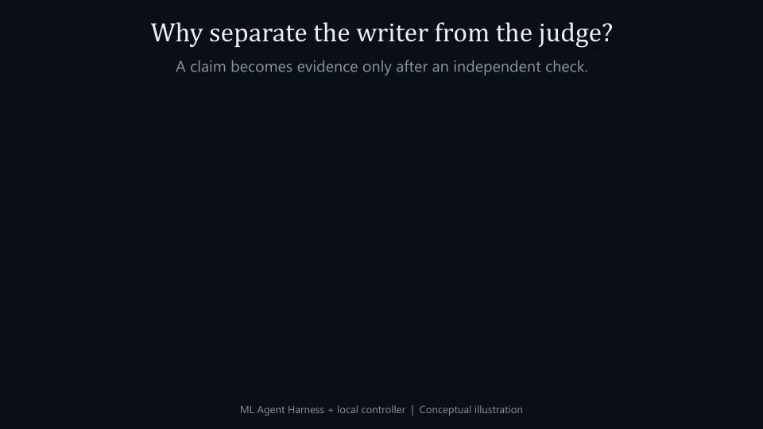
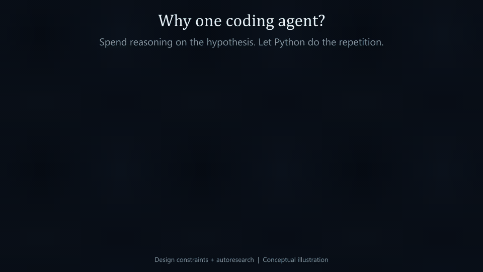
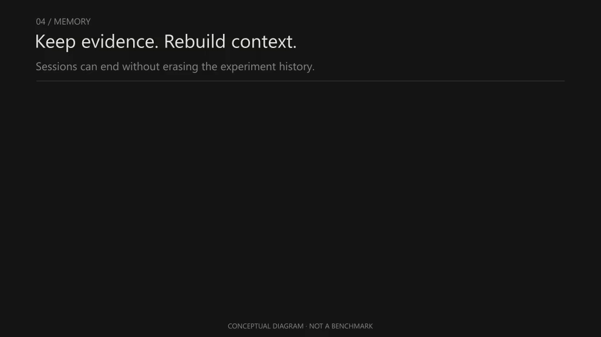
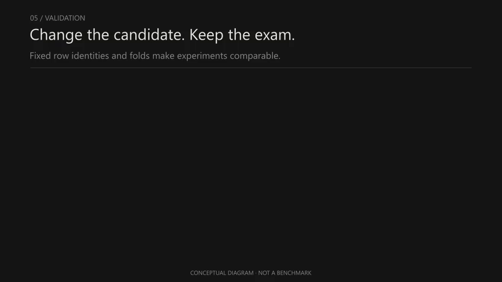
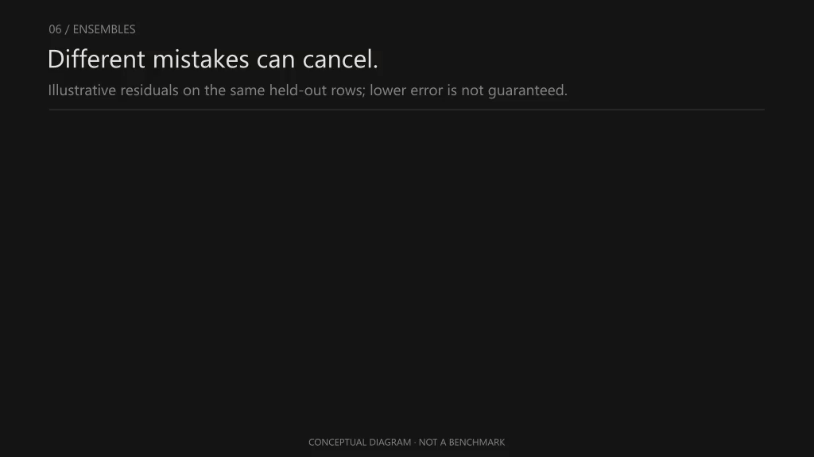

# Kaggle Agent Loop

Let **Claude Code or Codex** write experiments, test them, and learn from the results. You choose the competition and limits; the supervisor keeps score and saves the best work.

For tabular classification, regression, optimization, and occasional forecasting. Experiments run on your computer.

**[Start here](#1-get-the-tools)** · [Why this architecture?](#why-this-architecture) · [Detailed guide](OPERATING_GUIDE.md)

## How the loop works

The agent writes code. The supervisor tests and scores it. Failed code goes back for repair; measured results feed the next experiment.



Design reference: [ML Agent Harness](https://github.com/juliversa/ml-agent-harness). Our [controller](kaggle_agent/supervisor/controller.py) and [watchdog](kaggle_agent/supervisor/watchdog.py) enforce the checks outside the agent conversation.

## 1. Get the tools

Use **PowerShell on Windows** for the commands below.

- Install [Python 3.11 or newer](https://www.python.org/downloads/) and [Git](https://git-scm.com/downloads/). Allow their installers to add them to PATH.
- Pick one coding agent: [Claude Code](https://code.claude.com/docs/en/setup) or [Codex CLI](https://github.com/openai/codex#quickstart). Install it using its linked guide.
- Create a [Kaggle account](https://www.kaggle.com/). In [account settings](https://www.kaggle.com/settings), create/download legacy API credentials and save `kaggle.json` in `$HOME\.kaggle\kaggle.json`.

## 2. Install this project (once)

```powershell
git clone https://github.com/AlexDaPiggie/Agent_Loop_For_Kaggle.git _kaggle_shared
cd _kaggle_shared
python -m pip install -e ".[models]" kaggle
```

Sign in to **one** agent with your subscription account:

```powershell
codex login
# Or run claude, then use /login in Claude Code.
```

```powershell
ka setup
```

Choose your agent, CPU/RAM limits, run duration, and optional notifications when prompted. The agent uses your subscription login; metered API credentials are hidden from its environment. Plan usage limits still apply.

## 3. Start a competition

On Kaggle, join the competition and read/accept its rules first. Replace `COMPETITION-SLUG` in both lines below with the name at the end of its URL.

```powershell
ka new https://www.kaggle.com/competitions/COMPETITION-SLUG
cd ..\COMPETITION-SLUG
ka go --campaigns 1 --trials 2
```

Check the detected data columns and metric when prompted. Choose **no** for automatic submissions while learning.

A **trial** is one experiment idea. A **campaign** is a group of trials. The agent writes code; the supervisor runs small checks, scores the experiment, and saves useful results. A **champion** is the best validated run so far.

## 4. Check, stop, resume

Run these inside the competition folder. Use a second terminal while `ka go` is busy.

| I want to… | Run |
|---|---|
| See results | `ka status` |
| Open the progress dashboard | `ka dash` |
| Stop safely | `ka stop` (or Ctrl+C) |
| Continue later | `ka go` |
| Use Claude / Codex for this run | `ka go --agent claude` / `ka go --agent codex` |
| See the saved code versions | `ka history` |
| Send the best result to Kaggle | `ka submit` (asks first) |

**Command not found?** Replace `ka` with `python -m kaggle_agent.ka`, for example `python -m kaggle_agent.ka setup`. [More troubleshooting](docs/setup.md#troubleshooting).

## Cloud GPUs and more commands

- **[Cloud workflow](docs/setup.md#cloud-gpus-optional)** — run your own training job on Modal/Vast, then import predictions. `ka go` itself runs locally.
- **[Setup help and command reference](docs/setup.md)** — optimization competitions, extra packages, agent settings, research, submissions, and recovery.
- **[Operating guide](OPERATING_GUIDE.md)** — full technical reference.
- **[Original manual workflow](docs/legacy-workflow.md)** — preserved platform notes and prompt-based workflow.

## Why this architecture?

Each animation explains a tradeoff behind the implementation. These are conceptual diagrams, not benchmark results. The linked systems are design references, not bundled dependencies.

### One selected agent; Python does the repetition

A permanent swarm would use more conversation context and coordination. We use **one user-selected Claude Code or Codex session at a time** for the next idea, then Python for folds, scoring, and blending. You choose the agent, model, effort, and resource limits. Usage limits stop the run; they do not trigger a paid API fallback.



Reference: [autoresearch](https://github.com/karpathy/autoresearch)'s measurable experiment loop. The single-agent and spending constraints are this project's choices; see [shared rules](rules.md) and [agent adapters](kaggle_agent/agents/base.py).

### A small search portfolio, not an expanding tree

Always following the latest winner can miss a better direction. Expanding every idea spends too much computation. We keep **at most five active directions**, rank them from observed results and heuristic priorities, and reserve exploration turns for less-tried branches.


References: [MLEvolve](https://github.com/InternScience/MLEvolve) and [AIDE](https://github.com/WecoAI/aideml). Our [branch portfolio](kaggle_agent/research/branches.py) is a smaller heuristic implementation, not a reproduction of either search system.

### Persistent evidence, compact conversations

Replaying every old log wastes context. Forgetting everything repeats failures. Store the full experiment evidence outside the conversation, then retrieve a **compact brief** for the next session. Stopping or reaching a plan limit does not erase completed work.



References: [ML-Master](https://github.com/sjtu-sai-agents/ML-Master) and [EvoMaster](https://github.com/sjtu-sai-agents/EvoMaster). Their memory ideas informed our simpler [retrieval](kaggle_agent/research/retrieval.py) and [checkpoint](kaggle_agent/agents/session_manager.py) design.

### Change the model, keep the exam

A better score can come from an easier validation split. Freeze row identities, folds, and scoring so a model change has a meaningful comparison. The public leaderboard is feedback to inspect, not the score used to steer the experiment loop.



Reference: [MLE-bench](https://github.com/openai/mle-bench) as an evaluation reference. The concrete [validation contract](kaggle_agent/evaluation/validation.py) is local to this project; passing our checks is not evidence of a live competition medal.

### Keep complementary mistakes

The strongest single model is not always the most useful addition to a blend. Save aligned predictions and test whether a different model's errors **complement** the current ensemble. Keep the blend only if held-out checks support it.



Reference: [Chris Deotte's S6E5 write-up](https://www.kaggle.com/competitions/playground-series-s6e5/writeups/2nd-place-autonomous-codex-yolo), covered in our [source review](CHRIS_DEOTTE_2026_REVIEW.md). See the local [ensemble implementation](kaggle_agent/evaluation/ensemble.py).

[More design references](docs/design-sources.md) · [Animation source and rebuild instructions](docs/tools/README.md)
